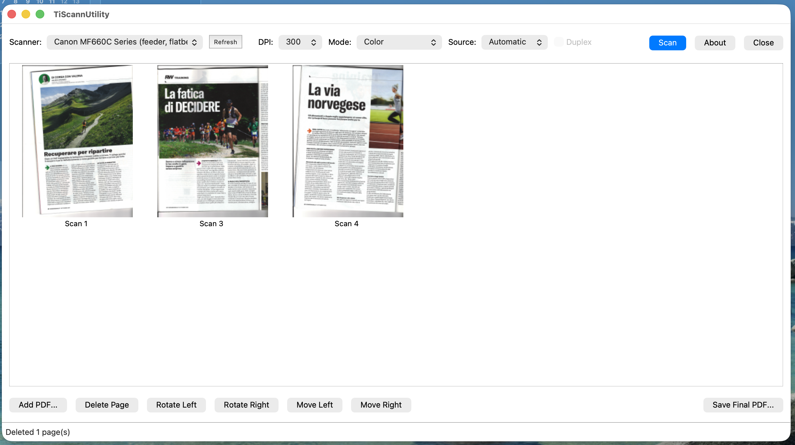

# TiScannUtility



A cross-platform desktop application (C++17 / Qt 6 & 5 Widgets) that scans from your **Canon MF660C Series** (and other network or USB scanners), lets you reorder, delete, and rotate pages, mix in pages from existing PDFs, and save one final PDF document.

No proprietary vendor drivers needed:
- **macOS**: Native AirScan (eSCL over IPP) via Apple's `ImageCaptureCore`.
- **Linux**: Native `SANE` (Scanner Access Now Easy) supporting eSCL, AirScan, and local USB.
- **Windows**: WIA / TWAIN backend scaffold.

Author: **Giuseppe Marco Randazzo** <gmrandazzo@gmail.com>

## License

TiScannUtility is free software licensed under the **GNU Affero General Public License v3.0 or later** — see [LICENSE](LICENSE). Copyright (C) 2026 Giuseppe Marco Randazzo.

**Qt linking:** this program links against Qt **dynamically** (shared libraries). The Qt libraries remain under their own license, the **GNU Lesser General Public License (LGPL) v3**, and are not covered by the AGPL. Dynamic linking is deliberate — it keeps the Qt framework under LGPL as required for closed/AGPL combination. Static linking of Qt is not supported by this build.

## Features

- **Scan Options**: Resolution (150/300/600 dpi), Color Modes (Color / Grayscale / Black & White via software thresholding to keep PDF sizes small).
- **Multiple Sources**: Smart automatic switching between the Automatic Document Feeder (ADF) and the Flatbed glass.
- **Add PDF**: Imports every page of an existing PDF as draggable thumbnails. Imported pages preserve vector content so text stays perfectly sharp.
- **Reorder & Rotate**: Move pages (buttons or drag-and-drop), rotate in 90° steps losslessly, and delete unwanted pages.
- **Preview**: Double-click any thumbnail to view a high-resolution, zoomable preview.
- **Save Final PDF**: Assembles everything in the order shown and opens the result in your default PDF viewer.

Note: the MF660C's document feeder advertises itself as *simplex* over the network (no duplex via AirScan), so the Duplex checkbox stays disabled. For double-sided documents, scan the stack face-up, then flip it over and scan again — the app merges everything into one document.

## Build

### macOS
Requires: macOS 14+, Xcode Command Line Tools, CMake, and Qt from Homebrew.

```bash
brew install qt cmake
cmake -B build -DCMAKE_PREFIX_PATH="$(brew --prefix qt)" -DCMAKE_BUILD_TYPE=Release
cmake --build build -j
```

The app is built at `build/TiScannUtility.app`. To package standalone dependencies:
```bash
$(brew --prefix qt)/bin/macdeployqt build/TiScannUtility.app
```

### Linux
Requires: CMake, GCC/Clang, Qt (Qt 6 or Qt 5 Widgets), SANE (`libsane1`), and Poppler tools (`poppler-utils` or `libpoppler-qt6-dev` / `libqpdf-dev`).

For automatic discovery of network scanners (AirScan / eSCL), install `sane-airscan` and ensure `avahi-daemon` is running:

```bash
sudo apt install libsane1 sane-airscan avahi-daemon
sudo systemctl enable --now avahi-daemon.socket avahi-daemon.service
```

```bash
cmake -B build -DCMAKE_BUILD_TYPE=Release
cmake --build build -j
```

## Self Tests (Headless)

You can run headless tests from the terminal to verify your scanning and PDF environment:

```bash
# Tests device discovery and opens a network scanner session:
build/TiScannUtility --selftest

# Tests the PDF assembly and vector import pipeline:
build/TiScannUtility --pdftest
```

## How It Works

```
TiScannUtility/
├── src/
│   ├── main.cpp                # Entry point and self-tests
│   ├── MainWindow.*            # UI behavior, device handling, and thumbnails
│   ├── mainwindow.ui           # Layout & widgets (editable via Qt Designer)
│   ├── ScannerBackend.h        # Abstract scanner backend interface (PIMPL)
│   ├── ScannerBackend.mm       # macOS: ImageCaptureCore bridge (Objective-C++)
│   ├── ScannerBackend_Sane.cpp # Linux: SANE bridge (eSCL, AirScan, USB)
│   ├── ScannerBackend_Win.cpp  # Windows: WIA scaffold
│   ├── PdfAssembler.h          # Abstract PDF Assembler interface (PIMPL)
│   ├── PdfAssembler.cpp        # macOS CoreGraphics / Linux & Windows QPDF, Poppler & Qt
│   ├── ImageConversion.*       # macOS: QImage ↔ CGImage conversion helpers
│   └── PreviewDialog.*         # Zoomable page preview dialog
├── cmake/                      # Assets, Info.plist, Desktop and SVG icon files
├── CMakeLists.txt              # Cross-platform CMake configuration
├── .github/workflows/          # GitHub Actions automated release workflow
├── .gitignore                  # Git ignore rules
└── README.md                   # Project documentation
```

## Troubleshooting

- **Scanner never appears**: Check that the printer is awake and on the same network.
  - **macOS**: Ensure System Settings → Privacy & Security → Local Network allows TiScannUtility.
  - **Linux**: Ensure `libsane1` and `sane-airscan` are installed and that `avahi-daemon` is running (`sudo systemctl enable --now avahi-daemon.socket avahi-daemon.service`). On distributions where `avahi-daemon` is kept disabled, you can either rely on the built-in eSCL mDNS fallback (`libsane-escl`) or add the scanner's IP manually under `[devices]` in `/etc/sane.d/airscan.conf` (e.g. `"My Scanner" = http://<ip>:80/eSCL`).
- **"no pages received"**: The feeder was empty (or flatbed glass empty) — load paper and scan again.
